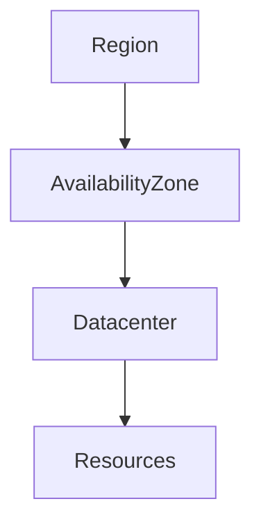
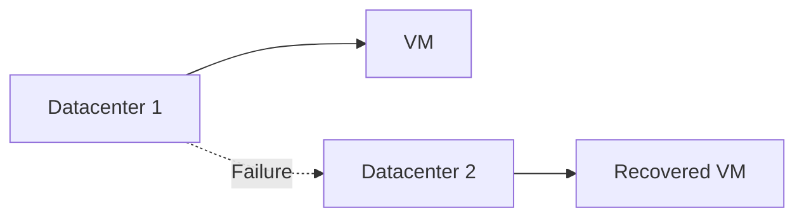
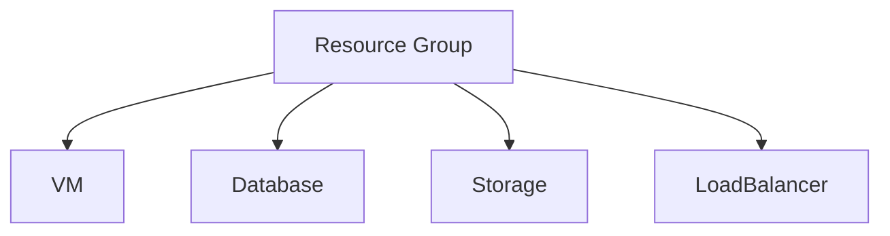
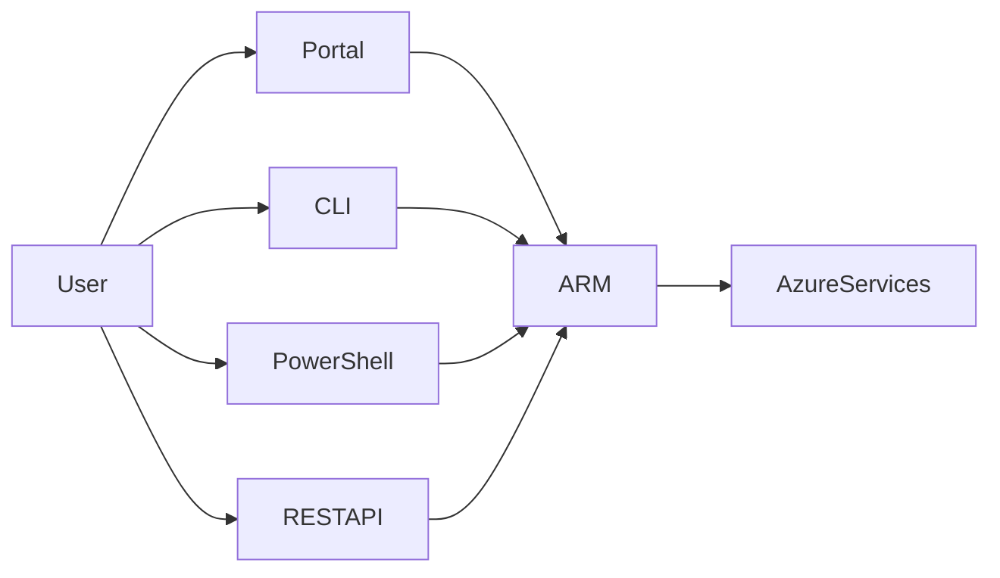
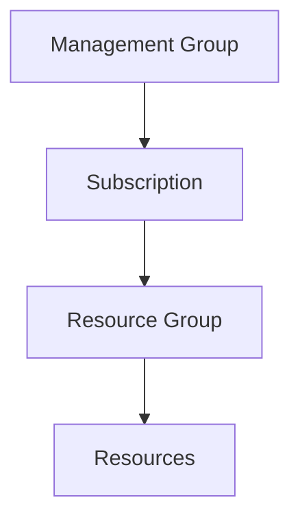
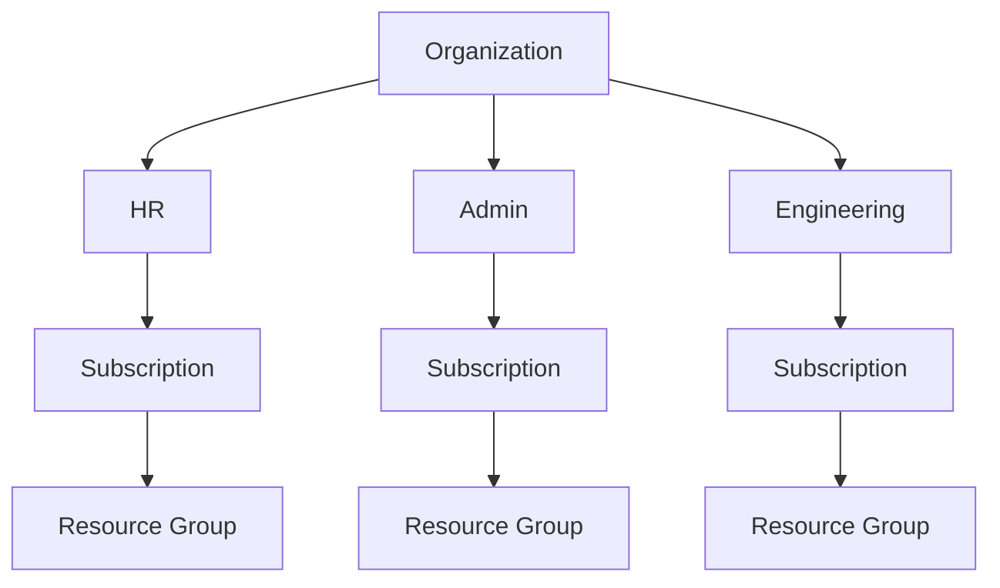
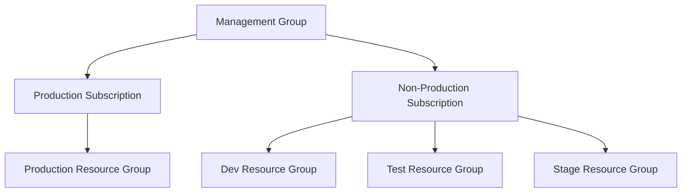
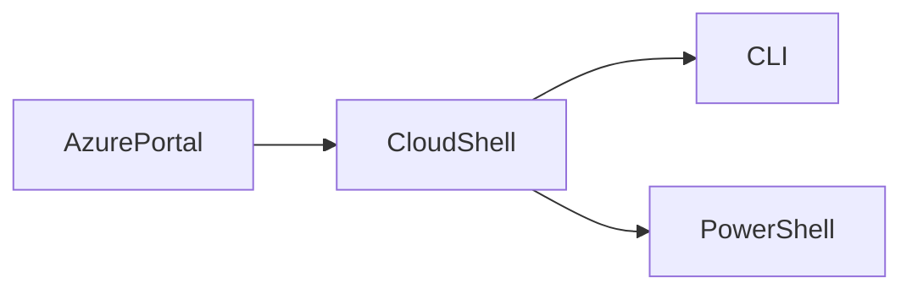
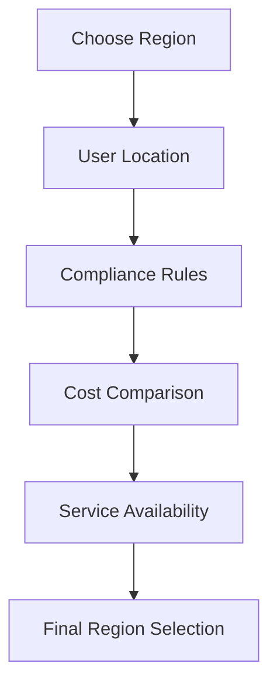
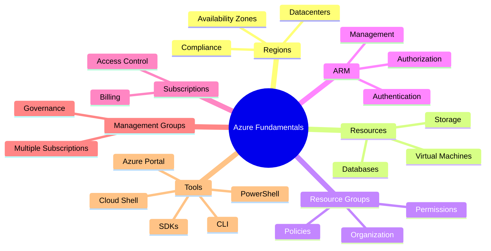

# Azure Fundamentals: Regions, Resource Hierarchy & Management Tools

## Overview

This session introduced the core Azure architecture, including:

- Regions
- Availability Zones
- Resource Groups
- Azure Resource Manager (ARM)
- Subscriptions
- Management Groups
- Azure Management Tools

---

# Azure Global Infrastructure

## Key Concepts

| Component | Description |
|-----------|-------------|
| Region | Geographic area containing one or more datacenters |
| Availability Zone (AZ) | Physically separate datacenters inside a region |
| Datacenter | Physical infrastructure where resources run |
| Resource | Any Azure service instance like VM, Storage Account, Database, etc. |

---

## Region Selection Factors

| Factor | Why It Matters |
|----------|--------------|
| User Location | Reduces latency |
| Compliance | Meets regulatory requirements |
| Cost | Pricing may vary between regions |
| Service Availability | Some services may not be available in all regions |

---

## Compliance Examples

| Requirement | Description |
|------------|-------------|
| RBI Guidelines | Indian customer data must remain within India |
| EU Data Residency | Customer data must stay within EU boundaries |

---

## Azure Infrastructure Hierarchy



---

# Availability Zones

Availability Zones protect workloads from datacenter failures.

## SLA Comparison

| Deployment Type | Availability |
|---------------|-------------|
| Single VM | 99.9% SLA |
| Availability Zone Enabled | Higher availability |
| Multi-Region Deployment | Disaster recovery solution |

---

## Availability Zone Architecture



---

## Benefits

- Protection against datacenter failures
- Automatic failover
- Independent power supply
- Independent cooling
- Independent networking
- Connected via private fiber network

---

# Azure Resources

A resource is any Azure service instance.

Examples:

- Virtual Machine
- Load Balancer
- Storage Account
- Database
- Azure Data Factory
- Virtual Network

---

# Resource Groups

A Resource Group (RG) is a logical container for Azure resources.

---

## Resource Group Characteristics

| Property | Value |
|-----------|---------|
| Cost | Free |
| Purpose | Organize related resources |
| Permissions | Can be assigned at RG level |
| Policies | Can be applied at RG level |
| Resource Membership | One resource belongs to only one RG |

---

## Example

A web application may contain:

- Web Server
- App Server
- Database
- Load Balancer

All these resources can exist inside a single Resource Group.

---

## Resource Group Structure



---

## Important Notes

✅ Resource Groups are free

✅ Resources can be moved between Resource Groups

✅ Resources can belong to different regions

✅ Resource Group metadata is stored in the region selected during creation

✅ Deleting a Resource Group deletes all resources inside it

---

# Azure Resource Manager (ARM)

ARM is the management layer of Azure.

It handles:

- Authentication
- Authorization
- Resource Creation
- Resource Updates
- Resource Deletion

---

## ARM Request Flow



---

## ARM Benefits

- Centralized management
- Security and access validation
- Consistent resource deployment
- Infrastructure automation support

---

# Azure Subscription

A Subscription is a logical boundary inside Azure.

---

## Subscription Functions

| Function | Purpose |
|----------|----------|
| Billing Boundary | Azure billing is generated per subscription |
| Access Control Boundary | Permissions can be assigned at subscription level |

---

## Important Rules

- Every resource must belong to a subscription.
- Every resource group belongs to a subscription.
- One Azure account can have multiple subscriptions.

---

## AWS vs Azure

| AWS | Azure |
|------|------|
| Billing at Account Level | Billing at Subscription Level |
| AWS Account | Azure Subscription |

---

# Azure Management Hierarchy



---

# Management Groups

Management Groups help manage multiple subscriptions centrally.

---

## Use Cases

- Governance
- Centralized Access Control
- Compliance Enforcement
- Organization-Wide Policies

---

## Management Group Structure



---

## When to Use Management Groups

| Scenario | Recommendation |
|------------|---------------|
| Single Subscription | Usually Not Required |
| Multiple Teams | Recommended |
| Multiple Business Units | Recommended |
| Organization Policies | Recommended |

---

# Azure Resource Organization Best Practices

## Typical Enterprise Structure



---

## Segregation Recommendations

| Level | Strategy |
|---------|----------|
| Management Group | Department / Business Unit |
| Subscription | Application / Environment |
| Resource Group | Logical Workload |

---

# Azure Management Tools

Azure can be managed using different interfaces.

| Tool | Purpose |
|---------|---------|
| Azure Portal | GUI Management |
| Azure CLI | Command-Line Management |
| Azure PowerShell | PowerShell-Based Management |
| Cloud Shell | Browser-Based CLI & PowerShell |
| REST APIs | Programmatic Access |
| SDKs | Application Development |
| Mobile App | Basic Resource Operations |

---

# Azure CLI

Preferred by users with Linux/Shell scripting experience.

---

## Command Structure

```bash
az <service> <action> <arguments>
```

---

## Examples

### List Resource Groups

```bash
az group list
```

### Create Resource Group

```bash
az group create \
  --name demo-rg \
  --location eastus
```

### Delete Resource Group

```bash
az group delete \
  --name demo-rg
```

---

# Azure PowerShell

Preferred by users with Windows/PowerShell experience.

---

## Login

```powershell
Connect-AzAccount
```

---

## Create Resource Group

```powershell
New-AzResourceGroup `
-Name demo-rg `
-Location EastUS
```

---

## Delete Resource Group

```powershell
Remove-AzResourceGroup `
-Name demo-rg
```

---

# Azure CLI vs PowerShell

| Azure CLI | Azure PowerShell |
|------------|------------------|
| Linux Friendly | Windows Friendly |
| Shell Based | PowerShell Based |
| Starts with `az` | Uses Az Cmdlets |
| Cross Platform | PowerShell Ecosystem |

---

## Recommendation

- Linux Background → Azure CLI
- Windows Background → Azure PowerShell

Both provide identical capabilities.

---

# Cloud Shell

Cloud Shell is a browser-based terminal available directly within Azure Portal.

---

## Features

- No local installation required
- Azure CLI support
- PowerShell support
- Built-in authentication
- File upload/download
- VS Code-style editor

---

## Cloud Shell Architecture



---

# Region Selection Decision Flow



---

# Key Interview Questions

| Question | Answer |
|-----------|---------|
| What is an Azure Region? | Geographic location containing one or more datacenters |
| What is an Availability Zone? | Isolated datacenter location within a region |
| Why use Availability Zones? | Protection against datacenter failures |
| What is a Resource Group? | Logical container for Azure resources |
| Can a resource belong to multiple Resource Groups? | No |
| Why do we need Subscriptions? | Billing and Access Control |
| What is ARM? | Azure Resource Manager, the Azure control plane |
| What is a Management Group? | Container for managing multiple subscriptions |
| Difference between Azure CLI and PowerShell? | CLI is shell-based, PowerShell uses cmdlets |
| Can resources inside a Resource Group belong to different regions? | Yes |

---

# Quick Revision

| Azure Component | Purpose |
|---------------|----------|
| Region | Geographic deployment location |
| Availability Zone | High availability within a region |
| Resource | Azure service instance |
| Resource Group | Logical grouping of resources |
| ARM | Resource management layer |
| Subscription | Billing and access boundary |
| Management Group | Governance across subscriptions |

---

# Summary



## Key Takeaway

Azure follows a layered hierarchy:

**Management Group → Subscription → Resource Group → Resources**

Everything in Azure is created as a **Resource**, managed through **ARM**, organized into **Resource Groups**, billed through **Subscriptions**, and governed through **Management Groups**.


This version is fully GitHub-compatible with proper Mermaid blocks, markdown tables, and formatting.