# Azure Virtual Machines (VMs) in Azure

## Overview

This session focused on:

- Virtual Machines (VMs)
- IaaS, PaaS, SaaS
- Shared Responsibility Model
- VM Planning
- VM Sizing
- Azure Pricing Models
- Managed Disks
- Availability Zones
- Availability Sets
- Fault Domains & Update Domains
- Virtual Machine Scale Sets (VMSS)
- Spot VMs
- VM Connectivity and Management

---

# Cloud Service Models

Azure supports three primary cloud service models:

| Service Model | Description |
|--------------|-------------|
| IaaS | Infrastructure as a Service |
| PaaS | Platform as a Service |
| SaaS | Software as a Service |

---

# Shared Responsibility Model

## On-Premises

You manage everything:

- Networking
- Storage
- Physical Servers
- Virtualization
- Operating System
- Runtime
- Applications
- Data

---

## IaaS (Virtual Machine)

Azure manages:

- Physical Infrastructure
- Networking
- Storage
- Compute Hardware

You manage:

- Operating System
- Runtime
- Applications
- Data
- User Access

---

## Shared Responsibility Diagram

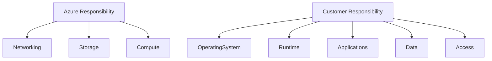

---

# Why Use Virtual Machines?

## Common Use Cases

- Lift & Shift Migration
- Development Environments
- Test Environments
- Hosting Websites
- Application Servers
- Backup & Recovery
- Big Data Processing
- High Performance Computing

---

# Lift and Shift Migration

When migrating from on-premises infrastructure to Azure:

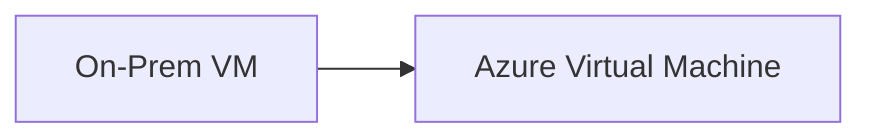

### Benefits

✅ Minimal changes to application

✅ Faster migration

✅ Lower migration effort

---

# VM Planning Checklist

Before creating a VM:

1. Network Planning
2. VM Naming
3. Region Selection
4. VM Size Selection
5. Pricing Model
6. Storage Planning
7. OS Selection
8. Availability Requirements

---

# Network Planning

VMs are deployed inside a network.

Without proper networking:

- Applications cannot communicate
- Databases become inaccessible
- APIs cannot be reached

---

## Example

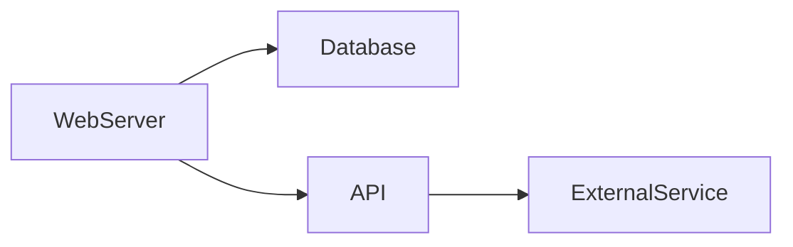

Without network connectivity, communication fails.

---

# VM Naming Convention

Good naming practices:

```text
IND-DEV-PAYROLL-01
```

Meaning:

| Part | Meaning |
|--------|----------|
| IND | India Region |
| DEV | Development Environment |
| PAYROLL | Application Name |
| 01 | Instance Number |

---

# Region Selection

Important factors:

| Factor | Reason |
|----------|--------|
| User Location | Lower Latency |
| Compliance | Regulatory Requirements |
| Cost | Region Pricing Differences |
| Existing Resources | Keep related resources together |

---

# VM Sizing

VM size determines:

- CPU
- RAM
- Performance
- Cost

---

## Example

| Usage | Recommended Size |
|----------|----------------|
| Development | Small VM |
| Production | Larger VM |
| Heavy Traffic Apps | High CPU/RAM VM |

---

# Azure Pricing Models

## 1. Pay-As-You-Go

Default pricing model.

Pay only for actual usage.

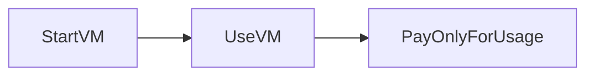

### Characteristics

✅ No commitment

✅ Flexible

✅ Ideal for testing

---

## 2. Reserved Instances

Commit resources for a longer duration.

Azure offers discounts.

### Benefits

- Up to 70% cost savings
- Suitable for long-running workloads
- Predictable usage

---

# VM Storage Components

Every VM contains:

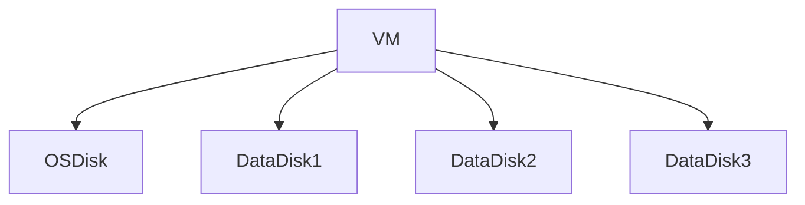

---

# OS Disk

Created automatically with VM.

Characteristics:

✅ Contains Operating System

✅ Deleted when VM is deleted

✅ Required for VM startup

---

# Data Disk

Additional storage attached to VM.

Characteristics:

✅ Stores application data

✅ Can be detached

✅ Can be attached to another VM

✅ Persists after VM deletion (optional)

---

# Managed Disk Types

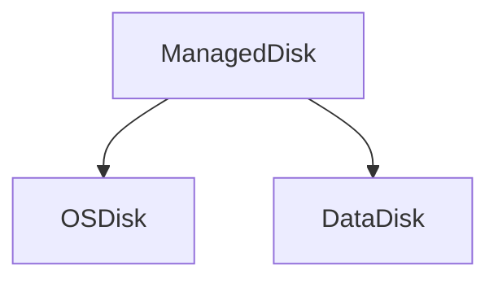

---

# VM Cost Components

VM cost consists of two parts.

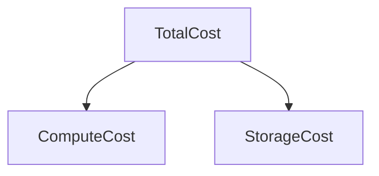

---

## Compute Cost

Based on:

- CPU
- RAM
- Running Duration

---

## Storage Cost

Based on:

- OS Disk
- Data Disks
- Allocated Storage

---

# VM States and Billing

| State | Compute Billing | Storage Billing |
|---------|----------------|----------------|
| Running | Yes | Yes |
| Stopped | No | Yes |
| Deleted | No | Depends |

---

# VM Families

Azure provides specialized VM families.

---

## General Purpose

Balanced CPU and RAM.

Examples:

- D Series
- B Series

Best For:

- Web Applications
- Small Databases
- General Workloads

---

## Compute Optimized

High CPU-to-RAM ratio.

Best For:

- Web Servers
- Batch Processing
- Application Servers

---

## Memory Optimized

High RAM-to-CPU ratio.

Best For:

- Caching
- Analytics
- In-Memory Databases

---

## Storage Optimized

Best For:

- Large Databases
- Heavy Disk Workloads

---

## GPU Optimized

Best For:

- AI/ML
- Video Rendering
- Gaming

---

## High Performance Computing (HPC)

Best For:

- Scientific Computing
- AI Training
- Big Data

---

# VM Family Overview

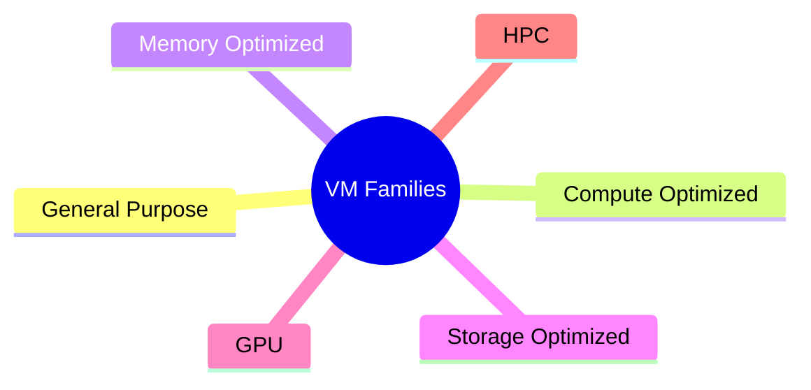

---

# Creating a Virtual Machine

## Required Information

| Field | Description |
|---------|-------------|
| Subscription | Billing Boundary |
| Resource Group | Resource Container |
| VM Name | VM Identification |
| Region | Deployment Location |
| Image | Operating System |
| Size | CPU & RAM |
| Credentials | Access Details |

---

# VM Creation Components

When Azure creates a VM, it automatically creates:

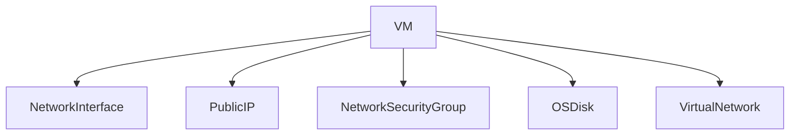

---

# VM Images

An Image is a template used to create VMs.

Examples:

- Windows Server
- Ubuntu
- Red Hat
- Palo Alto Appliance

---

## Image Concept

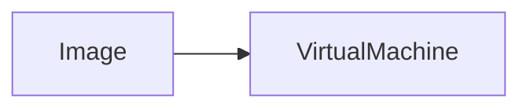

---

# Network Security

By default:

✅ Inbound traffic is blocked

Traffic must be explicitly allowed.

---

## Common Ports

| Port | Protocol | Purpose |
|--------|----------|-----------|
| 22 | SSH | Linux Access |
| 3389 | RDP | Windows Access |
| 80 | HTTP | Web Traffic |
| 443 | HTTPS | Secure Web Traffic |

---

# Backup vs Site Recovery

## Backup

Purpose:

- Restore deleted/corrupted data

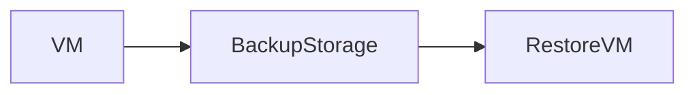

---

## Site Recovery

Purpose:

- Disaster Recovery

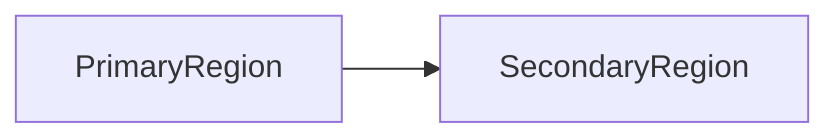

If a region fails:

Azure automatically recreates the VM in another region.

---

# Availability Options

Azure provides multiple availability strategies.

---

# Basic VM Deployment

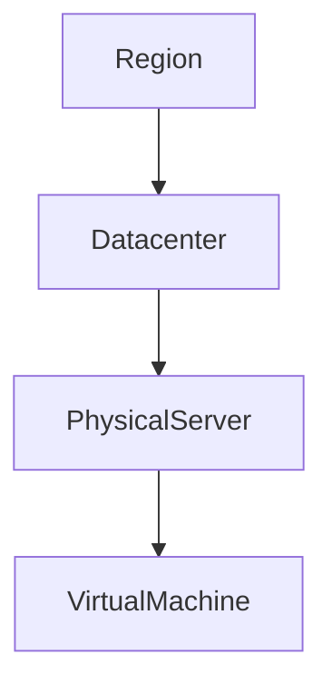

---

# Availability Zone

Protects against:

✅ Datacenter Failure

If an entire datacenter becomes unavailable:

Azure shifts workload to another datacenter within the zone.

---

## Availability Zone Architecture

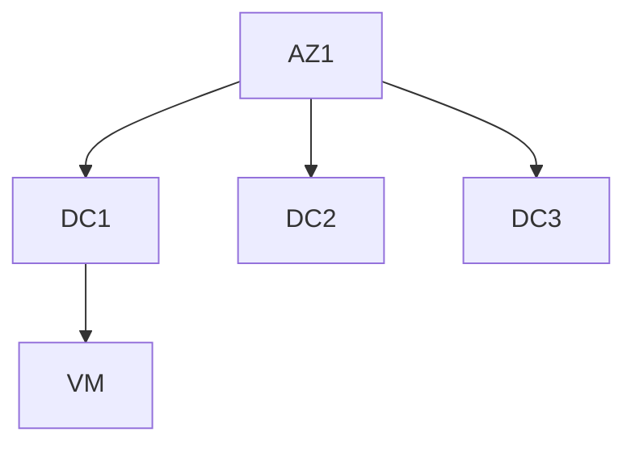

---

# Availability Set

Used when running multiple VMs.

Protects against:

- Hardware Failure
- Planned Maintenance

Availability Set consists of:

- Fault Domains
- Update Domains

---

# Fault Domain (FD)

Protects against:

- Power Failure
- Network Failure
- Hardware Failure

---

## Fault Domain Example

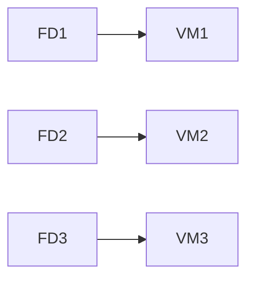

If FD1 fails:

VM2 and VM3 continue running.

---

## Fault Domain Facts

| Item | Value |
|---------|--------|
| Purpose | Protect against physical failures |
| Maximum Supported | 3 |

---

# Update Domain (UD)

Protects against planned maintenance.

Azure updates one update domain at a time.

---

## Update Domain Example

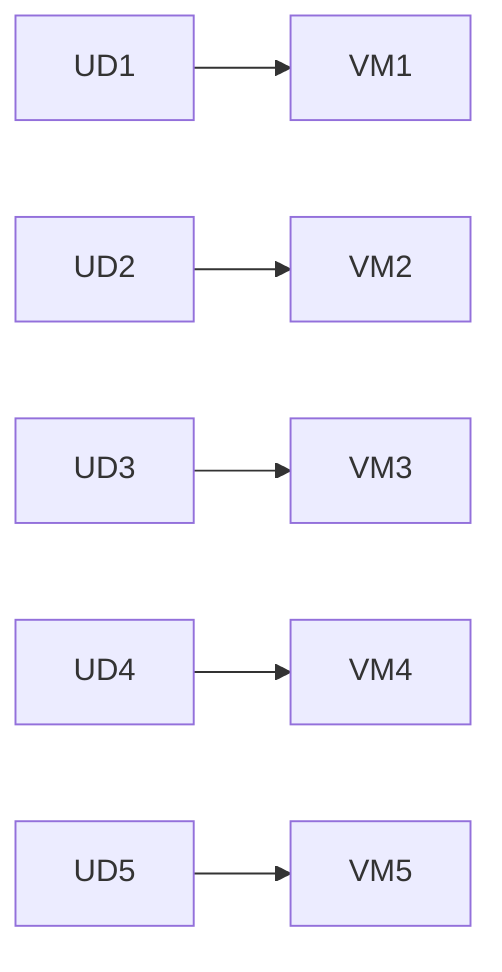

During maintenance:

- UD1 updated
- Others remain online

---

## Update Domain Facts

| Item | Value |
|---------|--------|
| Default | 5 |
| Maximum | 20 |
| Purpose | Planned Maintenance Protection |

---

# Availability Zone vs Availability Set

| Feature | Availability Zone | Availability Set |
|-----------|------------------|------------------|
| Protects Against Datacenter Failure | ✅ | ❌ |
| Protects Against Hardware Failure | ✅ | ✅ |
| Uses Fault Domains | ❌ | ✅ |
| Uses Update Domains | ❌ | ✅ |
| Multi Datacenter Protection | ✅ | ❌ |

---

# Virtual Machine Scale Sets (VMSS)

Azure equivalent of AWS Auto Scaling Group.

Allows automatic scaling.

---

## VMSS Architecture

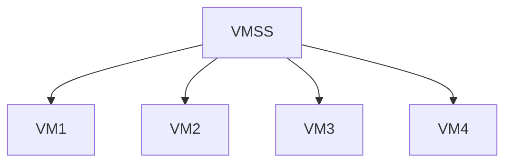

---

# Scaling Modes

| Mode | Description |
|---------|------------|
| Manual | Manually increase/decrease instances |
| Autoscale | Automatic scaling based on metrics |

---

# Autoscaling Example

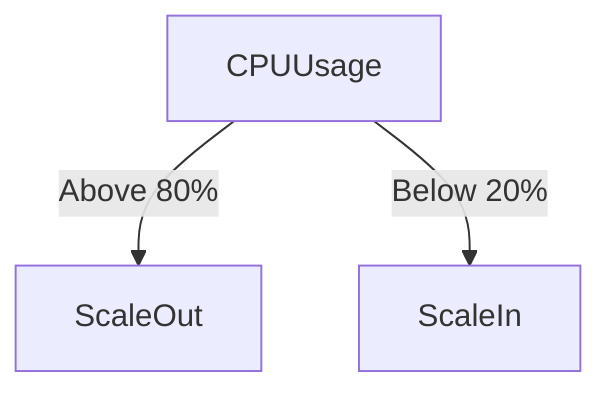

---

## Example Configuration

- Initial Instances = 2
- Minimum = 1
- Maximum = 5

Scale Out:

- CPU > 80% for 10 minutes

Scale In:

- CPU < 20%

---

# Predictive Scaling

Azure can forecast future scaling needs based on historical usage.

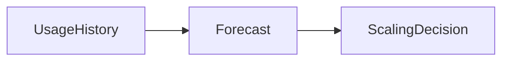

---

# Spot Virtual Machines

Spot VMs use Azure's unused capacity.

---

## Benefits

✅ Extremely Low Cost

✅ Significant Discounts

---

## Drawback

❌ No guarantee of availability

Azure can reclaim capacity anytime.

---

## Spot VM Concept

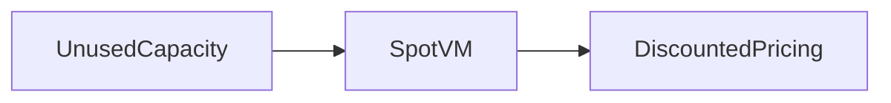

---

# VMSS + Load Balancer

When multiple VMs exist:

Users connect through a Load Balancer.

```mermaid
flowchart TD

Users --> LoadBalancer

LoadBalancer --> VM1
LoadBalancer --> VM2
LoadBalancer --> VM3
```

---

# Run Command Feature

Azure allows command execution without logging into VM.

---

## Linux Examples

```bash
uptime
```

```bash
apt update
```

---

## Windows Examples

```powershell
ipconfig
```

```powershell
Get-Service
```

---

# Key Interview Questions

| Question | Answer |
|-----------|---------|
| What is IaaS? | Infrastructure as a Service |
| Why use Virtual Machines? | Lift-and-shift, hosting applications, testing |
| Difference between OS Disk and Data Disk? | OS Disk contains OS, Data Disk stores application data |
| Components of VM Cost? | Compute Cost + Storage Cost |
| What happens when VM is stopped? | Compute billing stops, storage billing continues |
| What is a Fault Domain? | Protects against hardware and rack failures |
| What is an Update Domain? | Protects against planned maintenance |
| Maximum Fault Domains? | 3 |
| Default Update Domains? | 5 |
| Maximum Update Domains? | 20 |
| What is VMSS? | Azure Virtual Machine Scale Set |
| Azure equivalent of AWS ASG? | VMSS |
| What are Spot VMs? | Discounted unused Azure capacity |
| Difference between Backup and Site Recovery? | Backup restores data, Site Recovery provides DR |

---

# Quick Revision

```mermaid
mindmap
  root((Azure Virtual Machines))
    IaaS
    Images
    VM Sizes
    Managed Disks
      OS Disk
      Data Disk
    Pricing
      Pay As You Go
      Reserved
      Spot VMs
    Availability
      Availability Zones
      Availability Sets
      Fault Domains
      Update Domains
    Scaling
      VMSS
      Autoscale
    Security
      NSG
      RDP
      SSH
```

---

# Key Takeaway

A Virtual Machine is an **IaaS service** where Azure manages the infrastructure while you manage the operating system and applications.

To build production-grade VM deployments:

**VM → Availability Zone/Set → Load Balancer → VM Scale Set → Backup/Site Recovery**

This combination provides:

- High Availability
- Scalability
- Disaster Recovery
- Cost Optimization
- Operational Reliability