# Azure App Services (PaaS) & App Service Plan

## Session Overview

This session covered:

- VM Q&A Review
- Azure App Service
- IaaS vs PaaS vs Serverless
- App Service Plan (ASP)
- App Service Pricing Tiers
- Deploying Web Applications
- GitHub Integration
- Networking in App Services
- Application Insights
- Authentication
- Custom Domains
- Deployment Slots
- Slot Swapping
- Scale Up vs Scale Out

---

# Quick Recap: Virtual Machines

## Latest VM Series

Azure VM families have different versions.

Example:

| VM Family | Latest Version Example |
|------------|-----------------------|
| D-Series | V7 |
| E-Series | V7 |

Example:

```text
D2as_v7
E4as_v7
```

Latest version depends on the VM family. 【1-b14d0c】

---

# Azure Resource Hierarchy

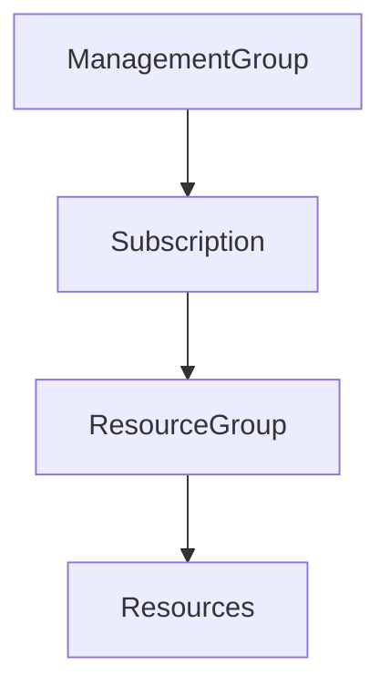

Resources under separate Management Groups can communicate, but not automatically.

Networking configuration is required. 【1-b14d0c】

---

# Availability SLA Recap

| Configuration | SLA |
|--------------|------|
| Single VM | 99.9% |
| VM with Availability Zones | 99.99% |

Availability Zones provide higher SLA because they protect against datacenter failures. 【1-b14d0c】

---

# VMSS Recap

## Can VMSS Use Different VM Types?

❌ No

VMSS is designed to scale identical VM instances.

Example:

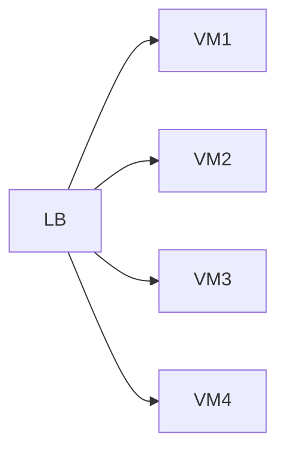

All VMs inside one VMSS use:

- Same Image
- Same Configuration
- Same Application

【1-b14d0c】

---

# Update Domains and Fault Domains

## Fault Domain

Protection against:

- Hardware Failure
- Power Failure
- Network Failure

Maximum:

```text
3 Fault Domains
```

Rule:

```text
More than 3 VMs → Use 3 Fault Domains
```

【1-b14d0c】

---

## Update Domain

Protection against:

- Planned Maintenance
- Azure Host Patching

Default:

```text
5 Update Domains
```

Maximum:

```text
20 Update Domains
```

【1-b14d0c】

---

## How to Decide Update Domains?

Example:

### Case 1

10 VMs

Allowed downtime:

```text
2 VMs at a time
```

Use:

```text
5 Update Domains
```

---

### Case 2

10 VMs

Allowed downtime:

```text
Only 1 VM
```

Use:

```text
10 Update Domains
```

【1-b14d0c】

---

# User Data Scripts

User Data can automate deployment.

Example:

```bash
apt update
apt install nginx -y
systemctl start nginx
```

For custom applications:

1. Download code from Storage Account/Azure Files
2. Install Web Server
3. Copy files to server directory
4. Start application

【1-b14d0c】

---

# Moving Beyond Virtual Machines

## Problem with VMs

When using VMs:

You manage:

- OS
- Runtime
- Patches
- Software
- Application

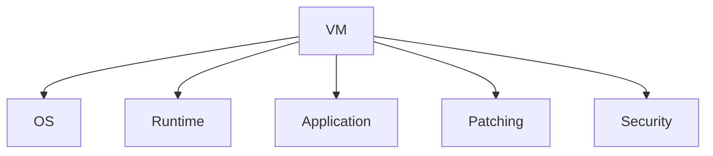

【1-b14d0c】

---

# Evolution of Application Hosting

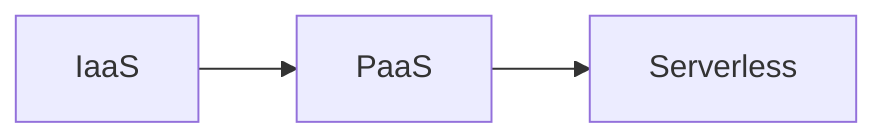

---

# Three Models Compared

| Feature | VM | Web App | Azure Functions |
|----------|------|---------|----------------|
| Server Visible | Yes | Yes | No |
| Server Managed by You | Yes | No | No |
| OS Management | Yes | No | No |
| Runtime Management | Yes | Partial | No |
| Application Management | Yes | Yes | Yes |

【1-b14d0c】

---

# Azure Web Apps

Azure Web App is a PaaS service.

You only provide:

- Code
- Runtime Selection

Azure handles:

- Infrastructure
- Server Maintenance
- Patching
- Scaling

【1-b14d0c】

---

# Serverless Explained

Serverless does NOT mean:

```text
No Server Exists
```

Serverless means:

```text
Servers are hidden from users
```

Example:

- Gmail
- Google Maps
- YouTube

Servers exist, but users never manage or see them.

Same concept in Azure Functions. 【1-b14d0c】

---

# Why Not Always Use Web Apps?

Azure Web Apps support only selected runtimes.

Supported:

- .NET
- Java
- Python
- PHP
- Node.js

If application uses unsupported technology:

Example:

- Scala
- R

You must use VMs.

【1-b14d0c】

---

# App Service Plan (ASP)

## What Is It?

Before creating a Web App, you need:

```text
App Service Plan
```

ASP defines infrastructure capacity.

Think of ASP like an Internet Plan.

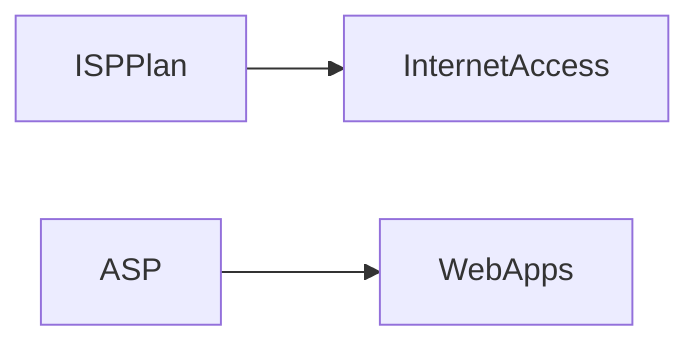

【1-b14d0c】

---

# App Service Plan Determines

- Region
- Number of Instances
- VM Size
- Pricing Tier

【1-b14d0c】

---

# ASP Architecture

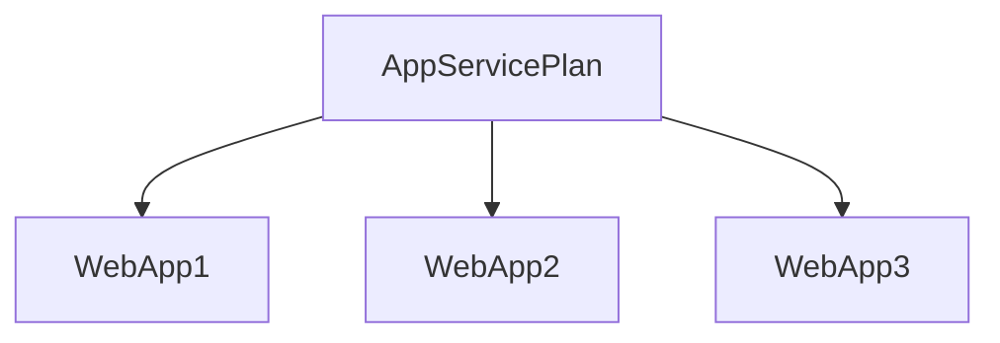

Multiple apps can share the same ASP.

【1-b14d0c】

---

# App Service Pricing Tiers

| Tier | Apps | Storage | Auto Scale |
|--------|--------|---------|------------|
| Free | 10 | 1 GB | No |
| Shared | 100 | 1 GB | No |
| Basic | Unlimited | 10 GB | No |
| Standard | Unlimited | 50 GB | Yes |
| Premium | Unlimited | 250 GB | Yes |
| Isolated | Unlimited | 1 TB | Yes |

【1-b14d0c】

---

# Auto Scaling Support

| Tier | Auto Scaling |
|---------|------------|
| Free | ❌ |
| Shared | ❌ |
| Basic | ❌ |
| Standard | ✅ |
| Premium | ✅ |
| Isolated | ✅ |

【1-b14d0c】

---

# Instance Limits

| Tier | Max Instances |
|--------|-------------|
| Free | 1 |
| Shared | 1 |
| Basic | 3 |
| Standard | 10 |
| Premium | 30 |
| Isolated | 100 |

【1-b14d0c】

---

# Shared vs Dedicated Compute

## Shared

Multiple customers share infrastructure.

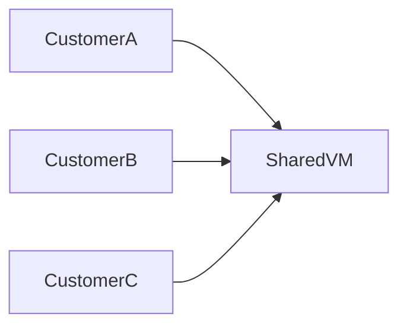

---

## Dedicated

Dedicated VM resources.

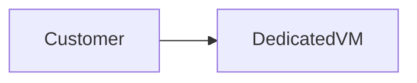

---

## Isolated

Dedicated VM + Dedicated Network

Best for:

- High security
- Enterprise workloads

【1-b14d0c】

---

# Scaling

## Scale Up

Increase size/capacity.

```text
B1 → B2 → B3 → Premium
```

【1-b14d0c】

---

## Scale Out

Increase number of instances.

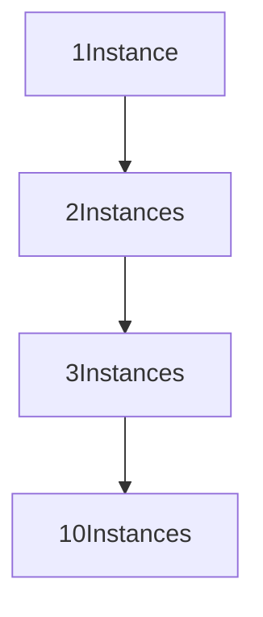

【1-b14d0c】

---

# Creating a Web App

Required Settings:

- App Name
- Runtime
- Region
- Operating System
- App Service Plan

---

## Supported Runtime Stacks

```text
.NET
Java
Node.js
PHP
Python
```

【1-b14d0c】

---

# GitHub Integration

Web App can connect directly with GitHub.

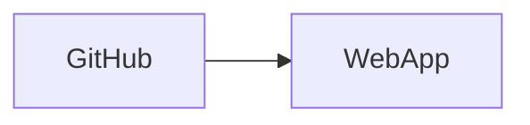

Supports:

- Continuous Deployment
- Automatic Updates

【1-b14d0c】

---

# Web App Networking

Unlike VMs:

❌ Web Apps are not deployed inside your VNet by default.

Azure hosts them on Microsoft-managed networks.

【1-b14d0c】

---

# Public Access

## Enabled

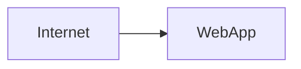

Anyone can access application.

---

## Disabled

Only private access allowed.

Used for internal applications.

【1-b14d0c】

---

# VNet Integration

Allows Web App to access private resources.

Example:

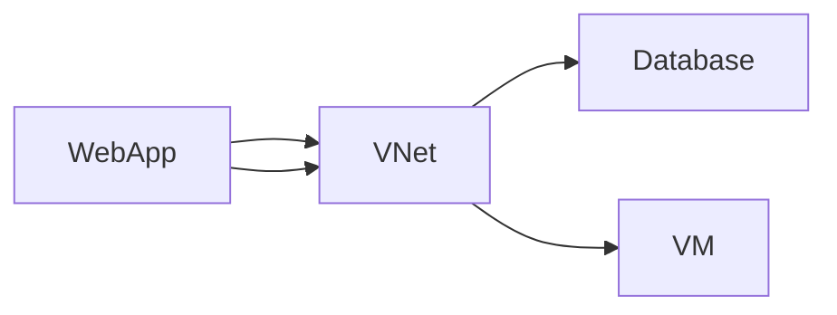

Used when:

- Accessing databases
- Accessing backend servers
- Calling internal APIs

【1-b14d0c】

---

# Monitoring

Two Monitoring Types

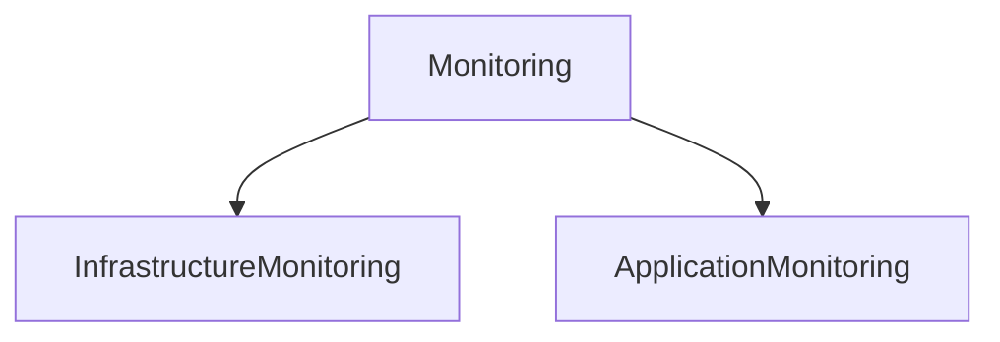

---

## Infrastructure Monitoring

Handled by:

```text
Azure Monitor
```

Tracks:

- Requests
- CPU
- Failures
- Performance

【1-b14d0c】

---

## Application Monitoring

Handled by:

```text
Application Insights
```

Tracks:

- Application Logs
- Exceptions
- User Activity
- Application Performance

Requires application integration.

【1-b14d0c】

---

# Authentication Providers

Web Apps support:

- Microsoft Entra ID
- GitHub
- Google
- Facebook
- Apple

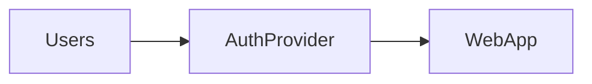

【1-b14d0c】

---

# Backups

Azure Web Apps support:

- Automatic Backups
- Manual Backups
- Restore Operations

【1-b14d0c】

---

# Custom Domains

Default URL:

```text
appname.azurewebsites.net
```

Custom URL:

```text
mycompany.com
```

Benefits:

- Branding
- Professional Appearance

【1-b14d0c】

---

# SSL Certificates

Used to secure websites.

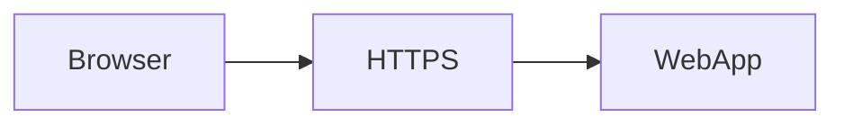

Purpose:

- Encryption
- Trust
- Secure Communication

【1-b14d0c】

---

# Service Connectors

Allow easy connection to Azure services.

Examples:

- Storage Account
- Key Vault
- Cosmos DB
- Event Hub
- Kafka

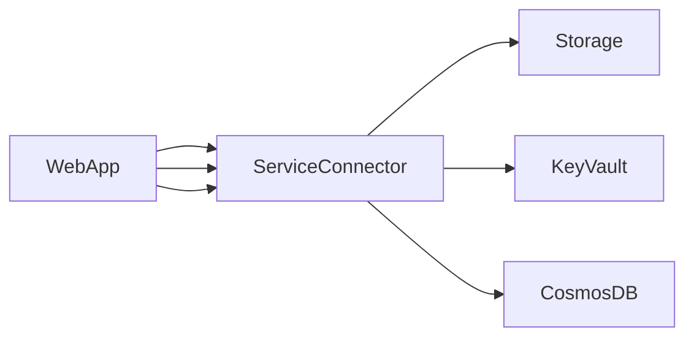

【1-b14d0c】

---

# Deployment Slots

One of the most important interview topics.

---

## What Is a Deployment Slot?

Separate deployment environments inside the same Web App.

Example:

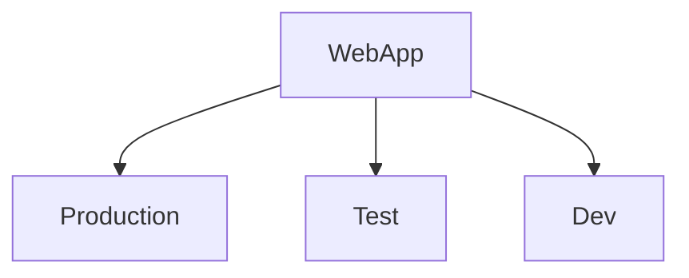

【1-b14d0c】

---

# Why Use Deployment Slots?

Allows:

✅ Testing

✅ Validation

✅ User Acceptance Testing

✅ Safe Release

✅ Easy Rollback

✅ Zero-Downtime Deployment

【1-b14d0c】

---

# Slot Architecture

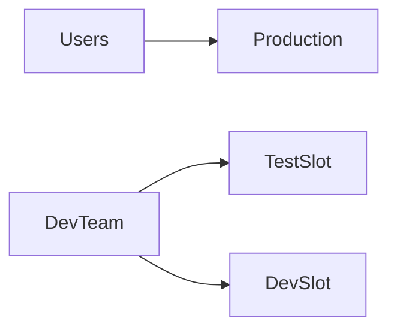

Production remains safe.

【1-b14d0c】

---

# Traffic Routing

Example:

```text
Production = 95%
Test Slot = 5%
```

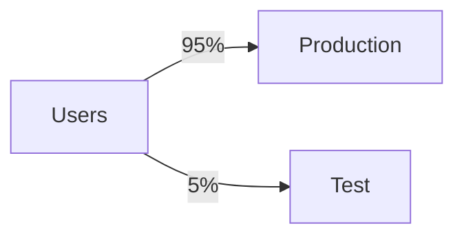

Used for:

- Canary Releases
- Gradual Rollouts

【1-b14d0c】

---

# Slot Swapping

Before Swap

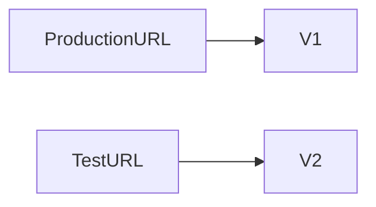

After Swap

```mermaid
flowchart LR

ProductionURL --> V2
TestURL --> V1
```

Only routing changes.

No downtime.

【1-b14d0c】

---

# Deployment Slot Limits

| Tier | Slots |
|--------|--------|
| Basic | 0 |
| Standard | 5 |
| Premium | 20 |
| Isolated | 20 |

【1-b14d0c】

---

# SSH Access

Azure App Services provide SSH access.

Used for:

- Viewing logs
- Troubleshooting
- Verifying deployments

```bash
ls
cat hostingstart.html
```

【1-b14d0c】

---

# Web App Benefits Over VMs

| Feature | VM | App Service |
|----------|----|------------|
| OS Management | You | Azure |
| Patching | You | Azure |
| Monitoring | Manual | Built-in |
| Scaling | Manual Configuration | Built-in |
| Deployment Slots | No | Yes |
| Deployment | Complex | Easy |

【1-b14d0c】

---

# Important Interview Questions

| Question | Answer |
|-----------|---------|
| What is Azure App Service? | PaaS for hosting web applications |
| What is ASP? | App Service Plan |
| Why ASP required? | Provides compute resources |
| Difference between Scale Up and Scale Out? | Scale Up = Increase Size, Scale Out = Increase Instances |
| What languages are supported? | .NET, Java, Python, PHP, Node.js |
| What is Application Insights? | Application-level monitoring |
| What is Deployment Slot? | Separate deployment environment |
| Why use Deployment Slots? | Safe testing and deployment |
| Standard Slot Limit? | 5 |
| Premium Slot Limit? | 20 |
| Web App inside VNet by default? | No |
| Purpose of VNet Integration? | Access private resources |

---

# Quick Revision

```mermaid
mindmap
  root((Azure App Services))
    PaaS
    App Service Plan
      Free
      Basic
      Standard
      Premium
      Isolated
    Runtime
      Python
      Java
      NodeJS
      PHP
      .NET
    Features
      Autoscaling
      Authentication
      Monitoring
      Backups
      Custom Domains
    Deployment Slots
      Dev
      Test
      Production
      Swap
    Monitoring
      Azure Monitor
      Application Insights
```

---

# Key Takeaway

**Azure App Service is a PaaS offering that eliminates infrastructure management and lets developers focus purely on application deployment.**

Production-grade Azure App Service architecture:

```mermaid
flowchart LR

GitHub --> DeploymentSlot

DeploymentSlot --> Production

Production --> AppServicePlan

AppServicePlan --> AzureInfrastructure
```

This provides:

✅ Auto Scaling  
✅ Managed Infrastructure  
✅ GitHub CI/CD  
✅ Blue-Green Deployment  
✅ Canary Releases  
✅ Easy Rollback  
✅ High Availability