Yes. The problem is that the previous version was optimized for viewing in chat, not for directly pasting into GitHub. Below is the GitHub-ready version with proper Markdown and Mermaid blocks.

# Azure Functions, Containers, ACI & ACR

## Session Overview

This session covered:

- Azure Functions (Serverless Computing)
- Event-Driven Architecture
- Triggers and Bindings
- Function App
- Scale-to-Zero Concept
- Containers vs Virtual Machines
- Docker Basics
- Docker Images & Containers
- Azure Container Instances (ACI)
- Azure Container Registry (ACR)
- DIY Containers vs Managed Containers

---

# Compute Services in Azure

Azure provides three major ways to run applications:

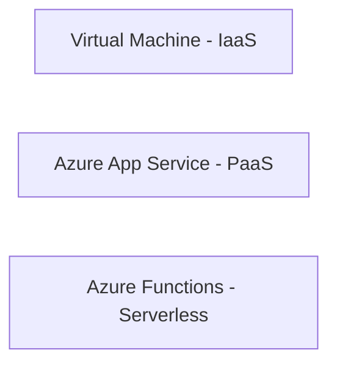

| Service | Infrastructure Visibility | Infrastructure Management |
|----------|----------|----------|
| Virtual Machine | Yes | Customer |
| App Service | Yes | Azure |
| Azure Functions | No | Azure |

---

# Azure Functions

Azure Functions is a:

> Serverless Compute Service

It allows execution of code without managing servers.

### Key Idea

> Focus on code, not infrastructure.

---

# What Does Serverless Mean?

❌ No servers exist

✅ Servers exist but are hidden from users

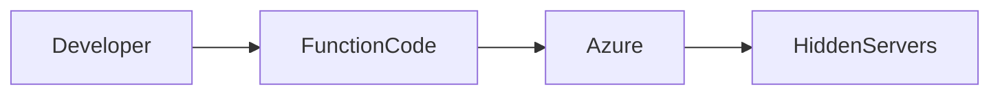

Azure manages:

- Infrastructure
- Scaling
- Availability
- Runtime

---

# Event-Driven Architecture

Azure Functions are designed primarily for:

> Event Driven Architecture

Application execution starts only when an event occurs.

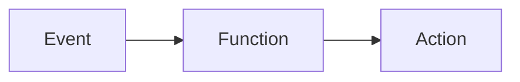

---

## Example 1: File Upload

Scenario:

```text
Upload File
↓
Trigger Function
↓
Compress File
```

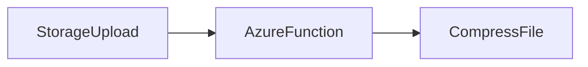

---

## Example 2: VM Stopped

Scenario:

```text
VM Stops
↓
Azure Function Triggered
↓
Restart VM
```

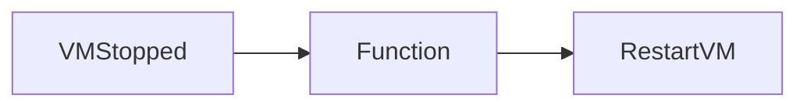

---

# Triggers

Triggers define:

> WHEN a function runs

Trigger = Input Event

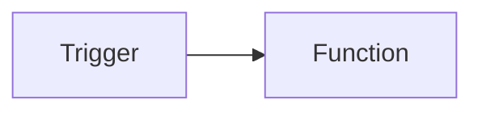

---

## Common Trigger Types

| Trigger | Example |
|----------|----------|
| HTTP | URL Request |
| Timer | Daily 9 PM Run |
| Storage Event | File Upload |
| Queue Message | Message Arrives |

---

# Bindings

Bindings define:

> WHERE function sends output

Binding = Output Destination

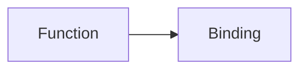

---

## Trigger vs Binding

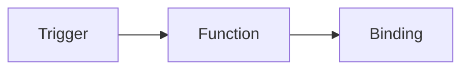

Example:

```text
File Uploaded
↓
Trigger
↓
Compress File
↓
Store in Database
↓
Binding
```

---

# Azure Functions Pricing Advantage

## Scale to Zero

Virtual Machine:

```text
VM running = Billing continues
```

Even if:

- No users
- No requests

Billing remains active.

Function App:

```text
No Trigger
↓
No Execution
↓
No Cost
```

---

## Example

Function:

```text
Trigger on File Upload
```

If no file is uploaded for a month:

```text
Execution Count = 0
Cost = 0
```

---

# Function App Architecture

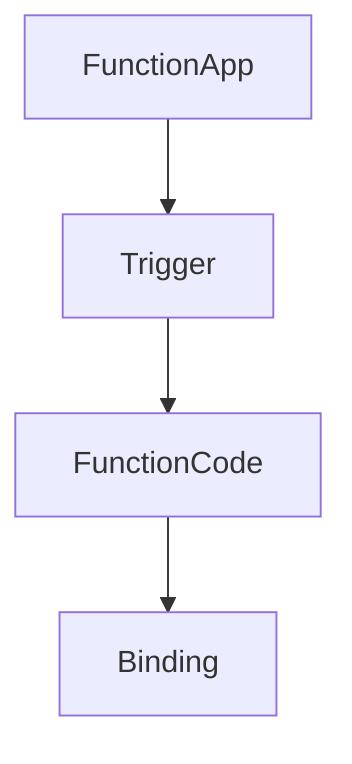

---

## Supported Languages

| Runtime |
|----------|
| Python |
| Java |
| Go |
| PowerShell |
| Custom Runtime |

---

# Azure Functions Networking

Supports:

- Public Access
- Private Access
- VNet Integration

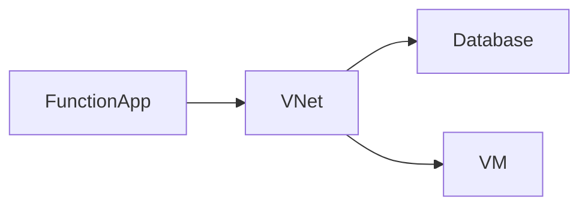

---

# Virtual Machines vs Containers

## Virtual Machine Architecture

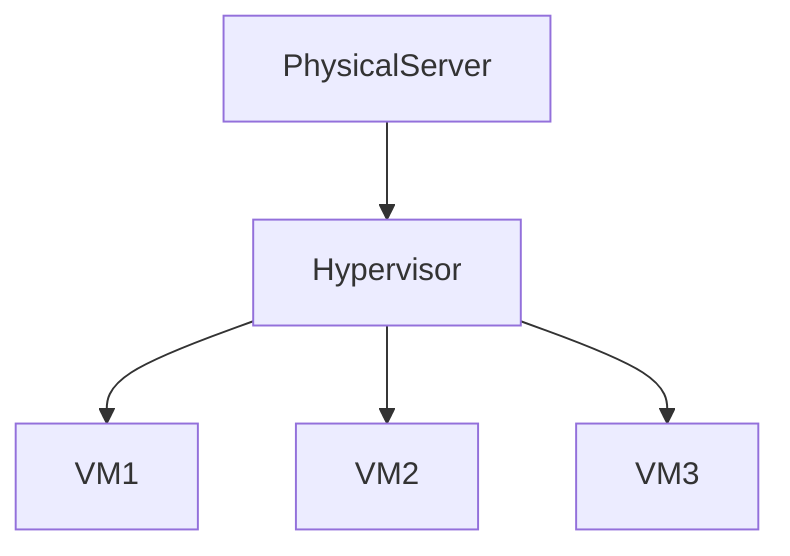

Each VM contains:

- Full OS
- Runtime
- Applications

---

## Why Containers Were Introduced

### Problem 1: Heavy Virtual Machines

Required:

```text
Application
Python Runtime
```

But VM also contains:

```text
Chrome
Zoom
Java
Unused Packages
```

Result:

> High resource consumption

---

### Problem 2: Environment Differences

| OS | Package Manager |
|------|------|
| Ubuntu | apt |
| Linux | yum |
| Windows | Different Commands |

Result:

```text
Works on My Machine
Fails on Yours
```

---

# Containers

Containers solve:

✅ Dependency issues

✅ Environment inconsistency

✅ Heavy deployments

---

## Container Terminology

### Image

Packaged application.

Contains:

- Application Code
- Runtime
- Libraries
- Dependencies

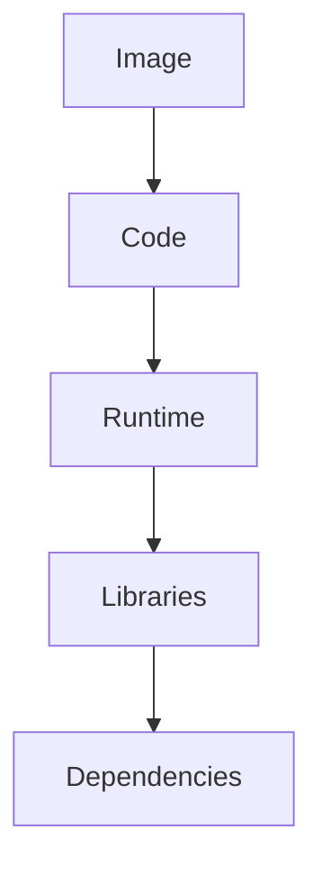

### Container

Running instance of an Image.

```text
Image = Blueprint
Container = Running Instance
```

---

## Virtualization vs Containerization

### Virtualization

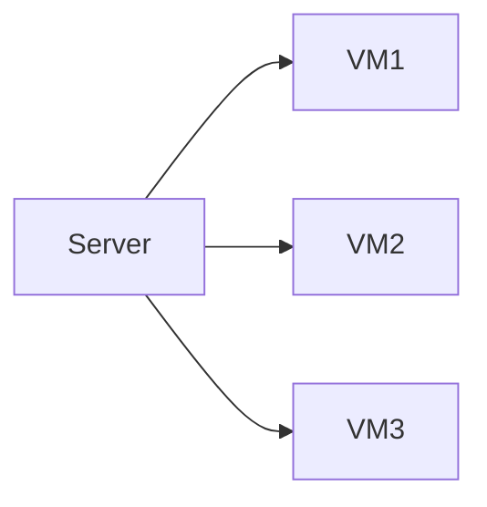

Each VM has its own operating system.

### Containerization

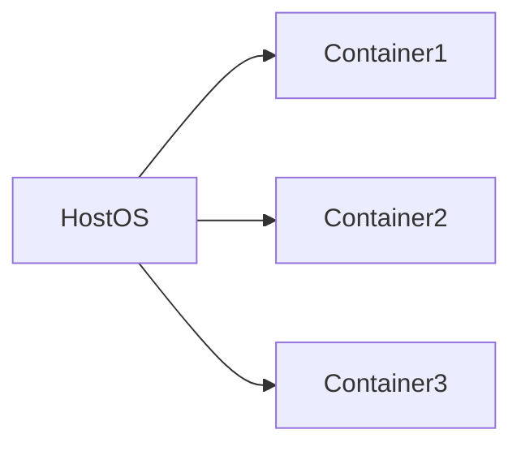

Containers share Host OS.

---

## Container Components

Contains:

```text
Application
Runtime
Dependencies
```

Does NOT contain:

```text
Full Operating System
```

Benefits:

- Lightweight
- Fast Startup
- Portable

---

# Docker

Most popular containerization platform.

Used to:

- Create Images
- Run Containers
- Manage Containers

---

## Docker Commands

### List Images

```bash
docker images
```

### List Running Containers

```bash
docker ps
```

### Pull Image

```bash
docker pull nginx
```

### Run Container

```bash
docker run -d --name mynginx -p 80:80 nginx
```

---

## Port Mapping

Example:

```bash
-p 80:80
```

Meaning:

```text
VM Port 80
↓
Container Port 80
```

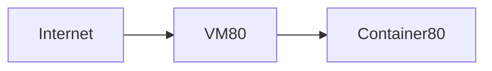

---

# DIY Container Deployment

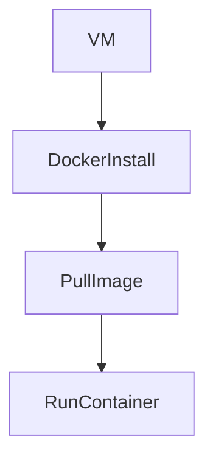

Steps:

1. Create VM
2. Install Docker
3. Pull Image
4. Run Container

---

# Azure Container Instances (ACI)

ACI is Azure's managed container service.

Instead of:

```text
Create VM
Install Docker
Manage Everything
```

You provide:

```text
Container Image
```

Azure runs it.

---

## ACI Architecture

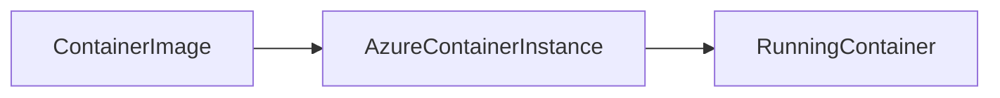

---

## Benefits of ACI

✅ No VM Management

✅ No Docker Installation

✅ Built-In Monitoring

✅ Logs Included

✅ Start / Stop Easily

✅ Fast Deployment

---

## Networking Modes

| Mode | Description |
|--------|--------|
| Public | Public IP |
| Private | Virtual Network Access |
| None | Fully Isolated |

---

## When to Use None?

Useful for:

- Batch Jobs
- Background Jobs
- Internal Processing

---

# Container Image Sources

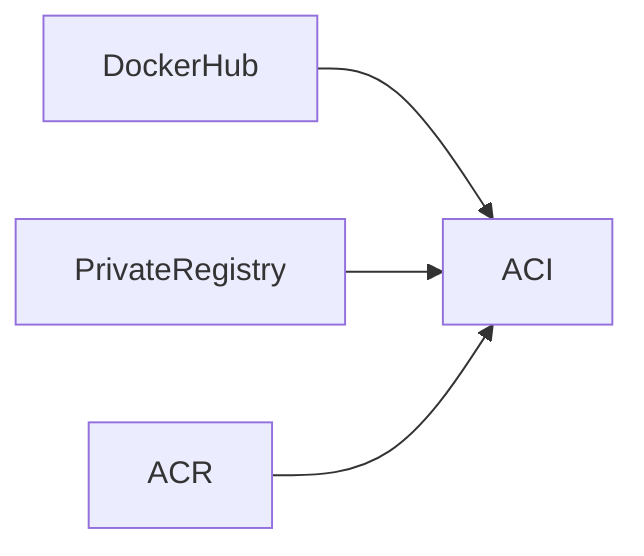

---

# Docker Hub

Public container registry.

Website:

```text
hub.docker.com
```

Contains:

- NGINX
- Ubuntu
- Python
- Java
- MySQL
- PostgreSQL

---

# Azure Container Registry (ACR)

ACR is:

> Fully Managed Private Docker Registry

Used to:

- Store Images
- Manage Images
- Secure Images

---

## Benefits of ACR

✅ Private Registry

✅ Geo Replication

✅ Security Controls

✅ Azure Integration

✅ Vulnerability Scanning

✅ Private Networking

✅ Customer Managed Keys

---

## Pricing Tiers

| Tier | Purpose |
|--------|--------|
| Basic | Learning & Small Workloads |
| Standard | Higher Throughput |
| Premium | Geo Replication + Advanced Security |

---

## Public vs Private Registry

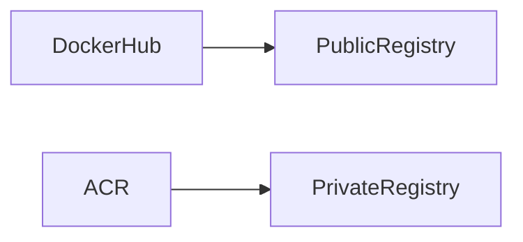

---

# Defender Integration

ACR integrates with:

> Microsoft Defender for Cloud

Benefits:

- Vulnerability Scanning
- Security Recommendations
- Image Security Assessment

---

# End-to-End Container Workflow

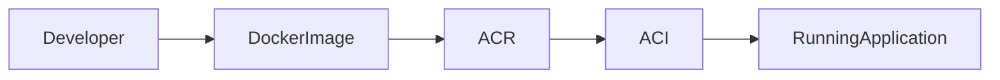

---

# Interview Questions

| Question | Answer |
|-----------|-----------|
| What is Azure Function? | Serverless compute service |
| What is Event-Driven Architecture? | Code runs when an event occurs |
| What are Triggers? | Inputs that invoke functions |
| What are Bindings? | Outputs from functions |
| What is Scale-to-Zero? | No execution = no cost |
| Function equivalent in AWS? | AWS Lambda |
| What is Container Image? | Packaged application with dependencies |
| What is Container? | Running instance of image |
| Difference between VM and Container? | VM has OS, Container shares host OS |
| What is Docker? | Containerization platform |
| What is ACI? | Managed Azure container service |
| What is ACR? | Private Azure container registry |

---

# Final Revision Mind Map

```mermaid
mindmap
  root((Azure Compute))
    Virtual Machines
      Full OS
      Customer Managed

    App Service
      PaaS
      Web Apps

    Azure Functions
      Serverless
      Triggers
      Bindings
      Scale-to-Zero

    Containers
      Images
      Docker
      Portability

    ACI
      Managed Containers
      Monitoring
      Scaling

    ACR
      Private Registry
      Geo Replication
      Security
```

---

# Key Exam Takeaways

1. Azure Functions = AWS Lambda
2. Trigger = Function Input Event
3. Binding = Function Output Destination
4. Scale-to-Zero reduces cost
5. Container = Running Instance of Image
6. Docker creates and runs containers
7. ACI provides serverless container hosting
8. ACR is Azure's private image registry
9. Containers share Host OS
10. ACR + ACI is a common Azure deployment pattern


This version can be pasted directly into GitHub README.md, Obsidian, GitLab, Azure DevOps Wiki, or MkDocs, and all Mermaid diagrams will render correctly.